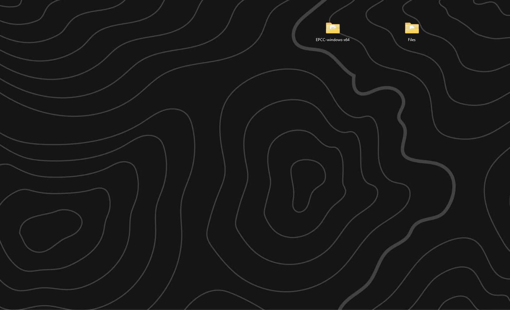
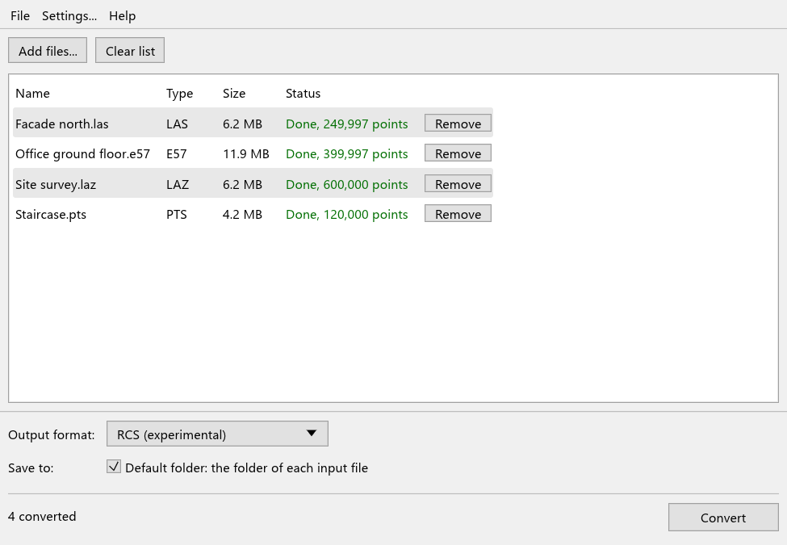
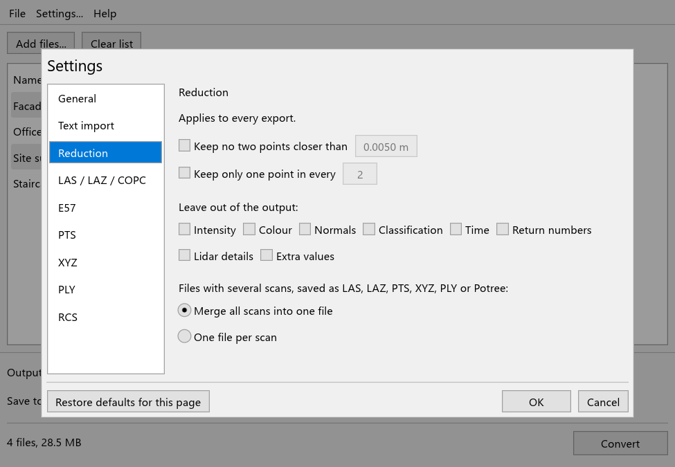

# EPCC – Easy Point Cloud Converter

<p align="center"></p>

Convert 3D scans (point clouds) from one file format to another: drop the files in, pick a
format, press *Convert*. Free, nothing to install, works offline, on Windows, macOS and Linux.

<p align="center">
  <a href="https://github.com/EPCCdev/EPCC/releases/latest/download/EPCC-windows-x64.zip"></a>
  <a href="https://github.com/EPCCdev/EPCC/releases/latest/download/EPCC-macos.zip"></a>
  <a href="https://github.com/EPCCdev/EPCC/releases/latest/download/EPCC-linux-x64.tar.gz"></a>
</p>
<p align="center"><sub>Always the latest version. Older versions and change notes are on the <a href="https://github.com/EPCCdev/EPCC/releases">releases page</a>.</sub></p>

<p align="center"></p>

## What it does

* Opens and saves **LAS, LAZ, COPC, E57, PTS, XYZ, PLY**, **Potree** (for web viewers) and, as
  an experiment, **RCS** files.
* Keeps what matters: positions, colours and intensity always; normals, classification, GPS
  time, return numbers, other lidar details and LAS extra bytes wherever the new format can
  hold them. Anything the new format cannot hold is reported, never silently dropped.
* Converts many files in one go and uses every processor core. Clouds larger than your
  computer's memory are fine.
* Can make files smaller by thinning out points that lie very close together.
* Never changes your original files.

## Getting started

1. **Download** the file for your computer with the buttons above.
2. **Unpack** it: on Windows right-click the file and choose *Extract All*; on macOS
   double-click it; on Linux use *Extract Here*.
3. **Start EPCC**: double-click `EPCC` in the unpacked folder (`EPCC.exe` on Windows,
   `EPCC.app` on macOS).

There is no installer. To remove EPCC, delete the folder. To update, download the new version
and replace the old folder (copy your `epcc-settings.toml` over to keep your settings).

### The first start

EPCC is free and not signed with a paid certificate, so your system asks once whether you trust
it:

* **Windows** shows "Windows protected your PC". Click *More info*, then *Run anyway*.
* **macOS** says it could not check EPCC for malicious software. Click *Done*, open *System
  Settings → Privacy & Security*, scroll down and click *Open Anyway* next to EPCC.
* **Linux**: if double-clicking does not start it, open a terminal in the folder and run
  `./EPCC`.

## Converting files

1. **Add files**: drag files or whole folders into the window, or click *Add files...*.
2. **Choose the output format** at the bottom of the window.
3. **Choose where to save**: by default each converted file goes next to its original. Untick
   *Default folder* to pick another folder for this conversion.
4. **Click *Convert*.** Each file shows its progress, then how many points were written.

<p align="center"></p>

If a file with the new name already exists, EPCC keeps both by adding a number, unless you
choose otherwise in the settings. Potree output is a folder rather than a file; an existing
folder is only replaced if it holds a point cloud.

## Settings

*Settings...* holds the choices that apply to every conversion. You set them once; EPCC
remembers them.

<p align="center"></p>

* **General**: default folders, what to do when a file already exists, how many files to
  convert at the same time, and whether to write a log file next to each result.
* **Text import**: PTS and XYZ files do not say which unit their numbers are in, or what each
  column means. Set it here if the automatic detection gets it wrong.
* **Reduction**: makes files smaller. *Keep no two points closer than* thins the cloud evenly;
  *Keep only one point in every* is a quick, uniform thinning. You can also leave out colour,
  intensity or other details you do not need.
* **One page per format** with its own options, for example the LAS version, decimal places
  for text formats, or whether RCS files get estimated normals.

Settings are stored in `epcc-settings.toml` next to the program, so a copied EPCC folder takes
its settings along. If that folder is read-only, they go to your user settings folder instead.

## Supported formats

| Format | Open | Save | Good to know |
|---|:-:|:-:|---|
| LAS | ✓ | ✓ | The common format for laser scans. Versions 1.0 to 1.4 are read; 1.2 or 1.4 is written. Return numbers, scan angle, point source, user data, point flags and extra bytes are kept. |
| LAZ | ✓ | ✓ | Compressed LAS: the same content in a much smaller file. |
| COPC (`.copc.laz`) | ✓ | ✓ | LAZ sorted for viewers that stream large clouds over the web. |
| E57 | ✓ | ✓ | A vendor-neutral scanner format. Keeps several scans with their names, scanner positions and grids, and normals; images optional. |
| PTS | ✓ | ✓ | A simple text format; several scans per file. |
| XYZ, TXT, ASC, CSV | ✓ | ✓ | Text columns. The meaning of each column is detected, or set in the settings. |
| PLY | ✓ | ✓ | Binary or text. Only the points are kept, no surfaces. Return numbers, lidar details and extra values are kept as vertex properties; extra values are read back from binary files only. |
| Potree | ✓ | ✓ | For viewing large clouds in a web browser with the Potree viewer. Saved as a folder, see below. |
| RCS | ✓ | ✓ | **Experimental**, see below. |

### About Potree support

* A Potree cloud is a folder (`scan.potree`) holding `metadata.json`, `hierarchy.bin` and
  `octree.bin`, in the Potree 2.0 format that the Potree viewer 1.8 and later loads. To view
  it, put the folder on a web server next to the viewer and load its `metadata.json`.
* Every attribute is kept: colours, intensity, classification, time, return numbers, lidar
  details, normals and extra values. Coordinates are stored with the precision set on the
  *LAS / LAZ / COPC* settings page (1 mm by default).
* Points are stored uncompressed. Potree's compressed (BROTLI) encoding is not written or read.
* To open a Potree cloud, add its folder or its `metadata.json`. Older Potree 1.x folders
  (with a `cloud.js`) can be opened too, if their points are stored as LAS, LAZ or, from
  version 1.7, as binary files. They are not written.
* A Potree cloud has no scans: several scans are merged into one cloud, or saved as one folder
  each, and their names and scanner positions are not kept.

### About RCS support

RCS support was developed independently by studying the file format, for interoperability.
EPCC is not affiliated with or endorsed by any software vendor. It is experimental:

* RCS stores positions on a 1 mm grid and keeps about one point per small cell of 1.5 to 3 mm
  (about 2.3 mm in typical clouds). A point less than 0.5 mm from the one before it is dropped.
* Normals (the direction a surface faces) that the original file does not have are estimated
  and only approximate. You can switch this off on the RCS settings page. Normals from the
  original file are always kept.
* Every RCS file is written with one fixed layout, whatever the original format.
* Written files have been tested with one consuming application only.
* One scan per file; project files that group several scans are not written.

## Known limitations

* LAS waveforms and near-infrared values are not carried over.
* LAS 1.2 output keeps up to 5 returns per pulse and no scanner channel; choose LAS 1.4 to keep
  them.
* *Keep no two points closer than* holds the remaining points in a temporary file next to the
  output once there are more than about 8 million of them (16 to 32 bytes per point, removed at
  the end). For files whose points are stored in random order rather than scan by scan, this
  makes thinning several times slower.

## Command line (for professionals)

The `command-line` folder of the download holds `epcc`, the same converter for scripts and
batch jobs:

```
epcc scan.e57 --to laz
epcc "C:\Scans\*.e57" --to las -o C:\Export --min-spacing 0.005
epcc site.pts --to e57 --units mm
epcc scan.laz --to rcs --no-rcs-normals
epcc site.laz --to potree
epcc --help
```

`epcc --help` lists every option, `epcc --formats` the formats. Settings saved in the window
apply to the command line too; `--factory-defaults` ignores them, which keeps scripts
independent of whoever last used the window. `epcc` returns 0 when every file was converted
or skipped, 1 if any file failed and 2 for invalid arguments.

## Building from source

See [docs/BUILDING.md](docs/BUILDING.md).

## Licence

MIT or Apache 2.0, at your option. The program window includes fonts from the egui project under
the SIL Open Font Licence 1.1 and the Ubuntu Font Licence 1.0.
